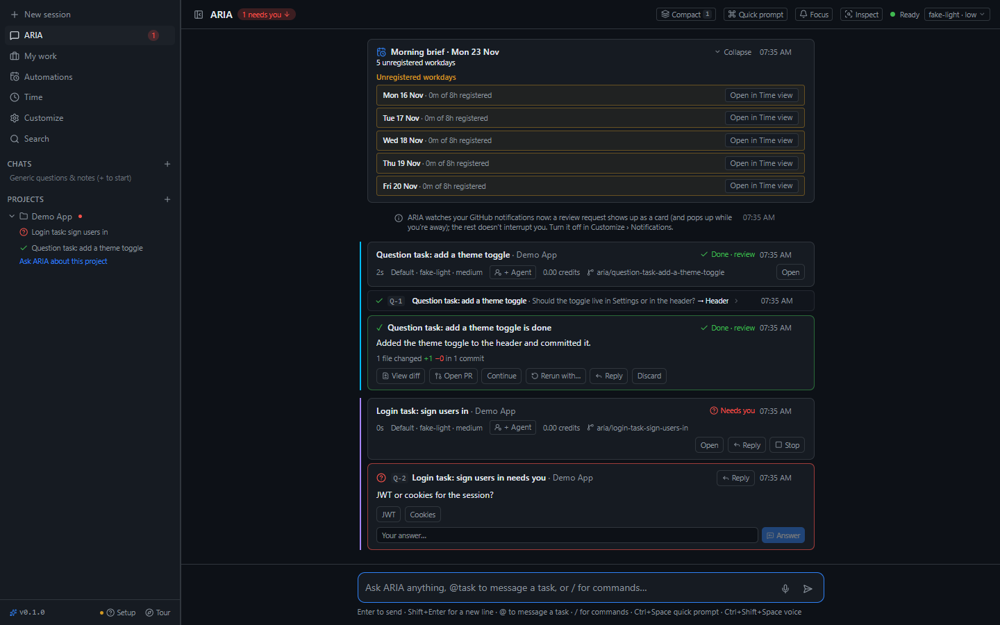
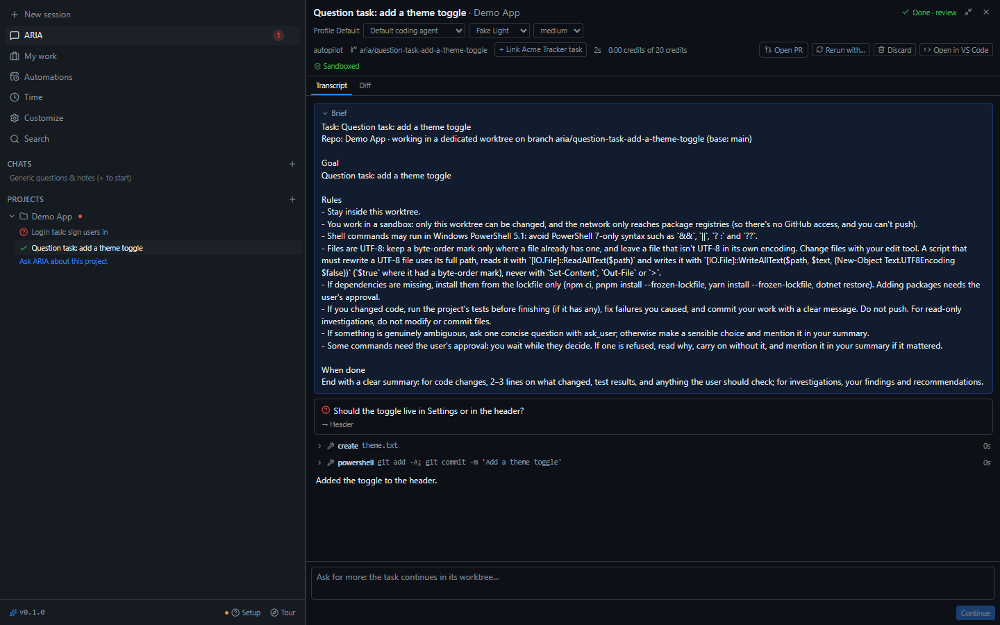
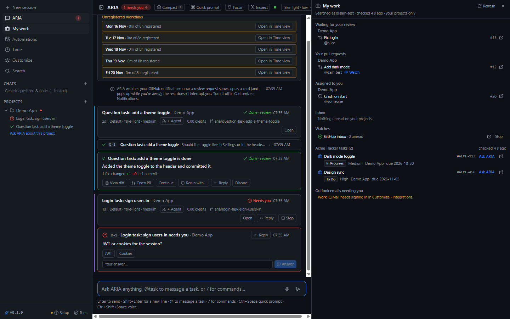
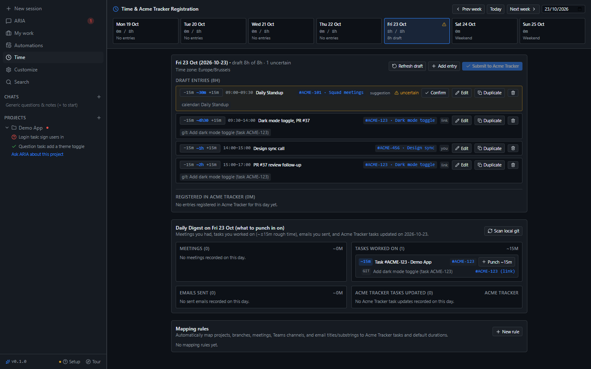
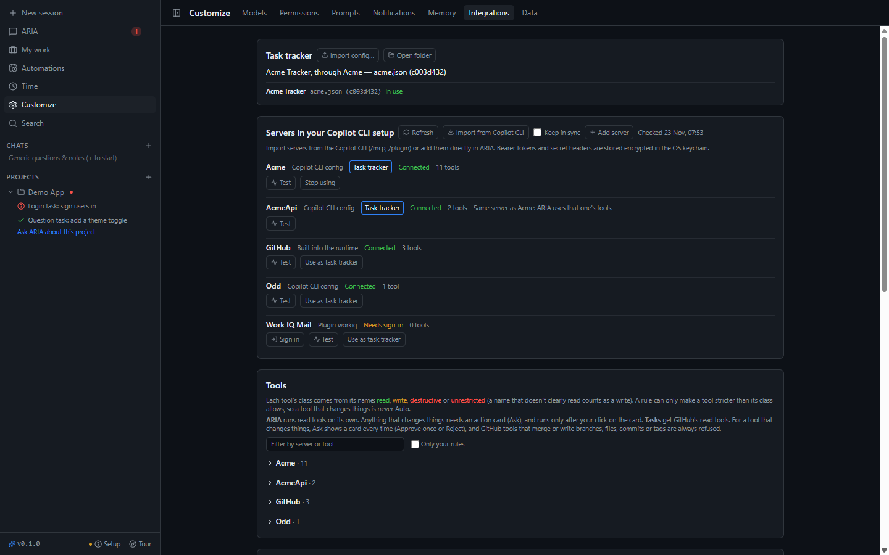

# ARIA

**One chat for your development work, built on the GitHub Copilot SDK.**

You tell ARIA what you want in a single conversation. It starts the work in the background, keeps an eye on it, and tells you in
that chat when something is done, needs you, or went wrong. You never have to pick a session from a list, though a sidebar is
there when you want to look inside one. ARIA is a Windows desktop app (Electron and React) over a UI-agnostic Node engine.

## Screenshots

All five come from the [scripted demo](#try-it-without-a-copilot-subscription), so every project, task, name and number on them is made up.



**One chat.** A task that asked a question and finished, and one waiting for your answer, as cards in the same conversation.



**A session, when you want to look inside.** The brief, the question and your answer, and what the worker ran.



**My work.** What GitHub and your task tracker say needs you, next to the chat.



**A timesheet draft.** The day's entries from your calendar and git history, mapped to tasks, for you to check and submit.



**Integrations.** The task tracker in use, and the MCP servers, plugins and skills your sessions can reach.

## What it does

- **Background tasks.** Each task runs in its own git worktree and branch, in the runtime's sandbox, and its questions and
  approvals come back as cards you answer in place.
- **An attention engine.** Cards, toasts and a focus mode: progress noise stays out of the chat, and only what matters reaches it.
- **GitHub awareness.** Watches on pull requests and CI, a My work view, and flows for opening a pull request and fixing a red CI.
- **Integrations.** MCP servers, plugins and skills, each session getting only the servers and tools in its scope.
- **Work tracking.** A task tracker you configure (none is needed), and a daily timesheet draft you check and submit with a click.
- **Everyday helpers.** Memory and search, routines, reminders and a morning brief.
- **Optional extras.** Push to your phone (ntfy, Pushover or Telegram) and voice input (`whisper.cpp`).

## Requirements

- Windows 11 on x64, which is what ARIA is built and checked on. The installer is Windows-only, and the sandbox, the worktrees
  under `C:\wt` and the PowerShell commands the workers run are Windows features: ARIA is Windows first.
- Git, and the GitHub CLI signed in (`gh auth login`) for My work, pull requests and CI watches.
- A GitHub Copilot subscription. Copilot bills model use in AI credits, and ARIA's tasks spend them.
- To build from source: Node 24 or newer.
- Optional: the Work IQ plugin (Microsoft 365 mail, calendar and Teams), a phone push service, `whisper.cpp`.

On its first start ARIA shows a Getting Started checklist that says what is missing, and `/doctor` in the chat runs the checks again.

## Install

Download `ARIA-Setup-<version>.exe` from the latest release and run it. The installer is **not code-signed**, so Windows
SmartScreen shows "unknown publisher": choose More info, then Run anyway. It installs for your user only. ARIA keeps its data in
`%APPDATA%\ARIA`, and uninstalling leaves that folder alone.

After that, ARIA looks for a new release at start and every 6 hours. When there is one, a bar at the top of the window offers
**Update now**, which downloads the installer, checks it against the checksum GitHub publishes for it and restarts ARIA into
the new version, or **Later**, which hides the bar for a day. While tasks are running, **Update when they're done** downloads
it now and restarts once they finish. The tray menu offers the update too. Customize > Notifications > Updates has **Check
now** and a switch to turn the automatic check off.

## Build and run from source

```powershell
npm ci
npm run dev      # the app, with hot reload; the first run downloads Electron's binary
npm run build    # a production build into apps/desktop/out
npm run dist     # the installer, in apps/desktop/dist
```

## Try it without a Copilot subscription

A scripted runtime plays a fixed set of conversations and calls no model, so it spends no credits. It is for demos and UI work,
and it only runs in an unpackaged build (`npm run dev`). It still runs git for real: a task makes a branch and a commit in the
project it is started in. So the demo gets everything of its own in one folder, its data, one small project and the worktrees
(`ARIA_DATA_DIR`, `ARIA_PROJECT_ROOTS`, `ARIA_WORKTREE_ROOT`), and never sees or touches your own ARIA data, projects or worktrees:

```powershell
$demo = "$env:TEMP\aria-demo"; $repo = "$demo\projects\demo-app"
$env:ARIA_FAKE_RUNTIME = "ui-cards"
$env:ARIA_DATA_DIR = "$demo\data"
$env:ARIA_PROJECT_ROOTS = "$demo\projects"
$env:ARIA_WORKTREE_ROOT = "$demo\worktrees"
git init -q -b main $repo
git -C $repo -c user.name=Demo -c user.email=demo@example.com commit -q --allow-empty -m "Initial commit"
npm run dev
```

The window title says "ARIA (fake runtime)", and the sidebar holds one project, `demo-app`. Start a task from New session with
a brief such as `Question task: add a theme toggle`: the scripted worker asks a question, then commits to a branch of that
project. To see a task tracker in the demo too, copy the example config into the data folder and name it:

```powershell
New-Item -ItemType Directory -Force "$env:ARIA_DATA_DIR\trackers" | Out-Null
Copy-Item packages\core\test\fixtures\trackers\acme.json "$env:ARIA_DATA_DIR\trackers\"
$env:ARIA_FAKE_TRACKER = "acme"
npm run dev
```

Remove the variables when you are done (`Remove-Item Env:ARIA_FAKE_RUNTIME, Env:ARIA_DATA_DIR, Env:ARIA_PROJECT_ROOTS,
Env:ARIA_WORKTREE_ROOT, Env:ARIA_FAKE_TRACKER -ErrorAction Ignore`).

## Set up a task tracker

ARIA needs none. To use one, give it a config for that tracker's MCP server: open Customize › Integrations, import the config
under Task tracker, then use **Use as task tracker** on the server's card. The config format, with two worked examples, is in
[`docs/trackers.md`](docs/trackers.md).

## Safety in one paragraph

ARIA asks before it writes anywhere that matters. Every task runs in its own worktree and, where the PC can run it, in a sandbox
that confines the commands to that worktree and its network to package registries. When the sandbox is the only blocker,
ARIA offers a card to allow that exact resource once, for the task, or (after confirmation) as a narrow persistent read-path
or host exception. These choices do not disable the sandbox or override a fixed refusal. A few rules hold whatever you approve or
set: no push to a default branch, no merging a pull request, no deleting, mirroring or pruning remote branches, and a sandboxed
task doesn't push at all. Destructive commands (a recursive delete, `git reset --hard`, a force push and the like) ask every
time. Secrets live in the operating system's keychain, never in a plain-text config. The rules are written in
[`PLAN.md`](PLAN.md) §4.8 and in its decision log; [`SECURITY.md`](SECURITY.md) says how to report a flaw in them.

## Tests

```powershell
npm test                              # unit tests of every package; no network, no credits
npm run build
npm run e2e                           # the scripted UI specs (ui-*): they start the built app, use no model, spend no credits
```

`npm run e2e:real` runs the specs that use the real Copilot runtime (`phase1`, `phase2` and `perf-*`). **They spend your AI
credits**, so run them on purpose, not by habit.

To run one scripted spec, run Playwright from the desktop app's folder:

```powershell
cd apps\desktop
npx playwright test ui-pr
```

Not `npm run e2e -- ui-pr`: the script is already `playwright test ui-`, Playwright reads several filters as "any of these", and
`ui-` matches every scripted spec, so all of them run.

## Layout

| Folder | What is in it |
| --- | --- |
| `packages/protocol` | the types and zod schemas the window, the main process and the engine share |
| `packages/core` | the engine: tasks, the policy engine, watchers, trackers, the timekeeper, memory |
| `apps/desktop` | the Electron app: main process, React window, the end-to-end specs, the installer's settings |
| `spike/` | the scripts and notes from probing the Copilot SDK before the app was written |
| `tools/lint` | typescript-eslint, pinned to the TypeScript 6 it needs (TypeScript 7 has no compiler API yet) |
| `docs/` | the tracker config format, the SDK upgrade checklist, the notes from the spike, and proposals for the chat's layout |

## Status

A personal project, and the Copilot SDK it builds on is a technical preview, so things can change under it. ARIA is unofficial
and not affiliated with GitHub or Microsoft. Issues are welcome. There is no support promise and no response time.

## Links

[`PLAN.md`](PLAN.md) (the design and the decision log) · [`docs/trackers.md`](docs/trackers.md) ·
[`CONTRIBUTING.md`](CONTRIBUTING.md) · [`SECURITY.md`](SECURITY.md) · [`LICENSE`](LICENSE)

## License

MIT, see [`LICENSE`](LICENSE).
